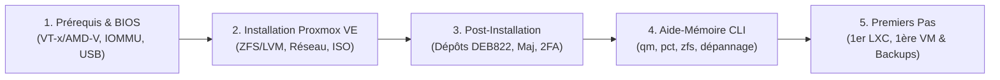

# 🟠 Guide d'Installation de Proxmox VE de A à Z (Français)

[](https://www.proxmox.com/)
[](https://www.debian.org/)
[](https://github.com/Naedel/Proxmox-FR/actions)
[](#)
[](./LICENSE)

Bienvenue sur **Proxmox-FR**, un dépôt complet et structuré en français pour vous accompagner pas à pas dans la préparation matérielle, l'installation, la post-installation et la prise en main de **Proxmox Virtual Environment (PVE)**.

Que vous montiez un **Homelab** sur un mini-PC ou un serveur dédié en production, ce guide couvre toutes les étapes cruciales ainsi que des scripts d'automatisation prêts à l'emploi.

---

## 🗺️ Parcours d'installation (Vue d'ensemble)



---

## 📚 Sommaire des Chapitres

| Chapitre | Titre & Lien | Contenu détaillé |
| :---: | :--- | :--- |
| **01** | [**Prérequis, BIOS/UEFI & Clé USB Bootable**](./docs/01-prerequis-bios-usb.md) | • Choix du matériel (CPU, RAM ECC/non-ECC, SSD/NVMe, NIC)<br>• Réglages BIOS/UEFI indispensables (`VT-x`/`AMD-V`, `VT-d`/`IOMMU`, `Above 4G`)<br>• Téléchargement et vérification SHA256 de l'ISO officielle<br>• Création de la clé USB bootable (**Ventoy**, **Rufus**, **BalenaEtcher**, `dd`) |
| **02** | [**Installation Pas-à-Pas de Proxmox VE**](./docs/02-installation-proxmox.md) | • Démarrage sur l'ISO (Mode Graphique, Terminal UI ou Debug)<br>• Choix du système de fichiers : **ext4 (LVM-Thin)** vs **ZFS (RAID 0/1/10/Z1)** vs **Btrfs**<br>• Paramétrage précis des options avancées (`hdsize`, `maxroot`, `minfree`, `ARC max`)<br>• Configuration réseau statique (IPv4/CIDR, Gateway, DNS, FQDN, schéma `vmbr0`)<br>• Première connexion à l'interface Web (`https://IP:8006`) |
| **03** | [**Post-Installation Essentielle & Sécurité**](./docs/03-post-installation.md) | • Bascule des dépôts APT au format moderne **DEB822 (`.sources`)** (`pve-no-subscription`)<br>• Désactivation propre du *nag screen* d'abonnement<br>• Mise à jour complète (`apt full-upgrade`) et installation du **microcode CPU** (Intel/AMD)<br>• Sécurisation : Double authentification (**TOTP / 2FA**), clés SSH, **Fail2ban**, pare-feu<br>• Monitoring S.M.A.R.T., alertes e-mail (SMTP), serveur de temps (`chrony`) |
| **04** | [**Aide-Mémoire CLI & Dépannage**](./docs/04-aide-memoire-commandes.md) | • Commandes essentielles `qm` (VM), `pct` (LXC), `pvesm` (Stockage), `zpool`/`zfs`<br>• Gestion des services système Proxmox (`pveproxy`, `pvedaemon`, `pve-cluster`)<br>• Procédures de dépannage courantes (changement d'IP, déblocage de VM, logs) |
| **05** | [**Premiers Pas : Stockages, 1er LXC, 1ère VM & Backups**](./docs/05-premiers-pas-vm-lxc.md) | • Comprendre enfin la différence entre les stockages **`local`** et **`local-lvm` / `local-zfs`**<br>• Arbre de décision : quand choisir un **Conteneur LXC** vs une **VM KVM** (et le cas Docker)<br>• Déployer son 1er conteneur LXC Debian/Ubuntu en 60 secondes<br>• Créer une VM performante (`VirtIO SCSI single`, `Discard/TRIM`, CPU `host`, `QEMU Guest Agent`)<br>• Planifier ses sauvegardes automatiques (`vzdump` ZSTD + politique de rétention) |

---

## 🛠️ Scripts & Fichiers de Configuration Inclus

Le dépôt contient un dossier [`scripts/`](./scripts/) et un dossier [`configs/`](./configs/) avec des outils prêts à l'emploi, commentés en français et idempotents.

### 🚀 Scripts Bash ([`scripts/`](./scripts/))

| Script | Description | Exécution rapide |
| :--- | :--- | :--- |
| [**`post-install.sh`**](./scripts/post-install.sh) | Script interactif (ou automatique avec `--yes`) qui configure les dépôts `no-subscription` au format moderne **DEB822 `.sources`**, désactive les dépôts `enterprise`, retire la popup d'abonnement, met à jour le système et installe les outils essentiels + microcode CPU. | `bash scripts/post-install.sh` |
| [**`check-hardware.sh`**](./scripts/check-hardware.sh) | Script d'audit matériel et de virtualisation : vérifie le support KVM (`vmx`/`svm`), l'activation de l'IOMMU (`DMAR`/`AMD-Vi`), les groupes IOMMU, l'état S.M.A.R.T. des disques et la santé des pools ZFS/LVM. | `bash scripts/check-hardware.sh` |

### 📄 Modèles de Configuration ([`configs/`](./configs/))

* [`configs/apt/`](./configs/apt/) : Fichiers sources APT (format moderne DEB822 `.sources`) prêts à être copiés dans `/etc/apt/sources.list.d/`.
* [`configs/network/interfaces.example`](./configs/network/interfaces.example) : Exemples commentés de configuration réseau (`/etc/network/interfaces`) pour Bridge simple (`vmbr0`), VLAN-aware et agrégation de liens (`Bonding LACP`).
* [`configs/security/fail2ban-jail-proxmox.local`](./configs/security/fail2ban-jail-proxmox.local) & [`fail2ban-filter-proxmox.conf`](./configs/security/fail2ban-filter-proxmox.conf) : Prison (`jail`) et filtre **Fail2ban** prêts à l'emploi pour protéger l'interface Web Proxmox (port `8006`) et le service SSH contre les attaques par force brute.

---

## ⚡ Démarrage Rapide (Post-Installation en 1 commande)

Une fois votre serveur Proxmox VE fraîchement installé (voir [Chapitre 02](./docs/02-installation-proxmox.md)), connectez-vous en **SSH** ou via le bouton **Shell** de l'interface Web en tant que `root`, puis lancez :

```bash
# 1. Télécharger le script de post-installation
curl -fsSL https://raw.githubusercontent.com/Naedel/Proxmox-FR/main/scripts/post-install.sh -o post-install.sh

# 2. Vérifier le contenu du script (toujours une bonne pratique !)
less post-install.sh

# 3. Rendre exécutable et lancer le script
chmod +x post-install.sh
./post-install.sh
```

Vous pouvez également vérifier que votre matériel et votre BIOS sont parfaitement configurés :

```bash
curl -fsSL https://raw.githubusercontent.com/Naedel/Proxmox-FR/main/scripts/check-hardware.sh | bash
```

---

## 📂 Structure du Dépôt

```text
Proxmox-FR/
├── .github/workflows/
│   └── lint.yml                           # GitHub Action (ShellCheck & vérification des liens)
├── README.md                              # Accueil et vue d'ensemble du dépôt
├── LICENSE                                # Licence MIT
├── docs/
│   ├── 01-prerequis-bios-usb.md           # Chapitre 1 : Matériel, BIOS/UEFI et clé USB
│   ├── 02-installation-proxmox.md         # Chapitre 2 : Installation de Proxmox VE pas-à-pas
│   ├── 03-post-installation.md            # Chapitre 3 : Dépôts DEB822, mises à jour, sécurité & 2FA
│   ├── 04-aide-memoire-commandes.md       # Chapitre 4 : Cheat-sheet CLI (qm, pct, zfs, réseau)
│   └── 05-premiers-pas-vm-lxc.md          # Chapitre 5 : local vs local-lvm, 1er LXC, 1ère VM & Backups
├── scripts/
│   ├── post-install.sh                    # Script d'automatisation de post-installation (DEB822)
│   └── check-hardware.sh                  # Script de diagnostic matériel (VT-x, IOMMU, SMART)
└── configs/
    ├── apt/
    │   ├── pve-no-subscription.sources    # Dépôt PVE gratuit (format DEB822 Proxmox 8/9)
    │   └── ceph-no-subscription.sources   # Dépôt Ceph gratuit (format DEB822)
    ├── network/
    │   └── interfaces.example             # Modèles /etc/network/interfaces commentés
    └── security/
        ├── fail2ban-jail-proxmox.local    # Configuration prison Fail2ban pour Proxmox
        └── fail2ban-filter-proxmox.conf   # Filtre regex Fail2ban pour le démon pvedaemon
```

---

## 🤝 Contribuer

Les contributions, corrections de coquilles et suggestions d'améliorations sont les bienvenues !
1. **Forkez** ce dépôt
2. Créez une branche (`git checkout -b amelioration/mon-ajout`)
3. Commitez vos changements (`git commit -m "Ajout d'une section sur..."`)
4. Ouvrez une **Pull Request**

---

## 📜 Licence

Ce projet est distribué sous licence **MIT**. Voir le fichier [LICENSE](./LICENSE) pour plus de détails.
