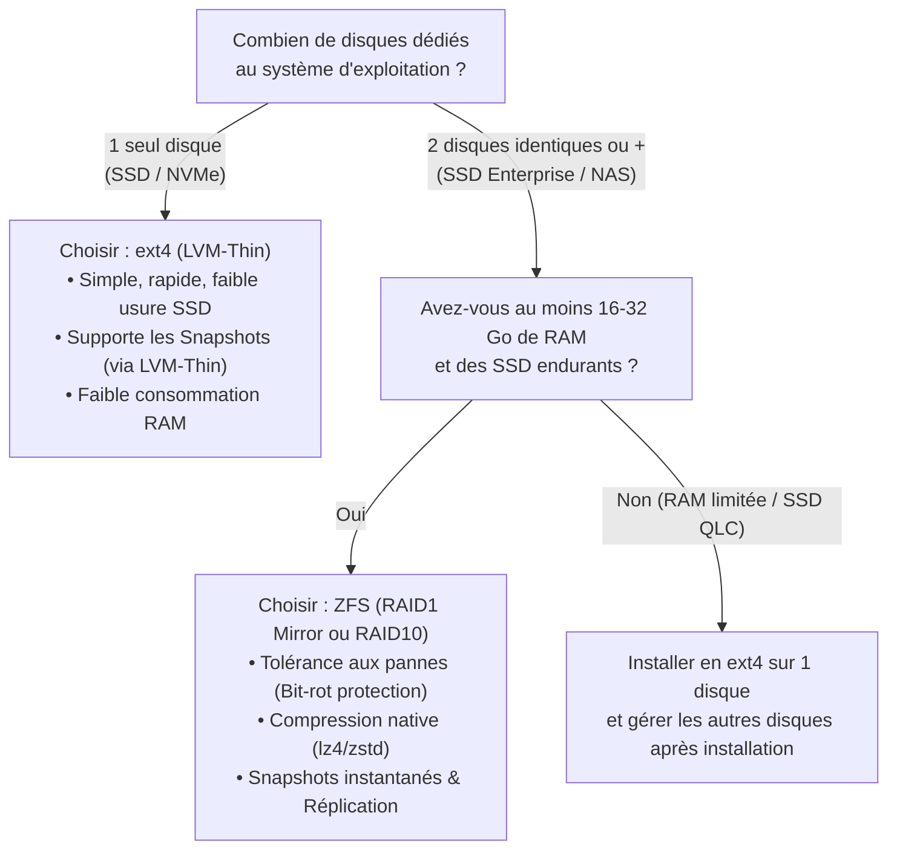
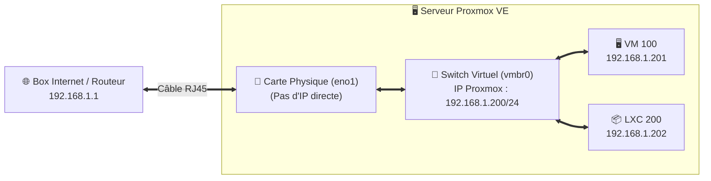

# Chapitre 02 : Installation Pas-à-Pas de Proxmox VE

[⬅️ Chapitre précédent : Prérequis & BIOS](./01-prerequis-bios-usb.md) | [🏠 Accueil](../README.md) | [Chapitre suivant : Post-Installation ➡️](./03-post-installation.md)

---

Ce chapitre détaille chaque écran de l'installateur officiel de **Proxmox VE**, avec une explication approfondie des choix de **système de fichiers (ext4/LVM-Thin vs ZFS)**, du **partitionnement avancé** et de la **configuration réseau**.

---

## 📑 Table des matières

1. [Démarrage sur la clé USB (Menu d'amorçage)](#1-démarrage-sur-la-clé-usb-menu-damorçage)
2. [Contrat de licence (EULA)](#2-contrat-de-licence-eula)
3. [Choix du disque cible et du système de fichiers](#3-choix-du-disque-cible-et-du-système-de-fichiers)
4. [Localisation, fuseau horaire et clavier](#4-localisation-fuseau-horaire-et-clavier)
5. [Mot de passe `root` et adresse e-mail](#5-mot-de-passe-root-et-adresse-e-mail)
6. [Configuration réseau (IP statique, Passerelle, DNS, FQDN)](#6-configuration-réseau-ip-statique-passerelle-dns-fqdn)
7. [Résumé, installation et premier redémarrage](#7-résumé-installation-et-premier-redémarrage)
8. [Première connexion à l'interface Web (`https://IP:8006`)](#8-première-connexion-à-linterface-web-httpsip8006)
9. [Dépannage des erreurs fréquentes à l'installation](#9-dépannage-des-erreurs-fréquentes-à-linstallation)

---

## 1. Démarrage sur la clé USB (Menu d'amorçage)

1. Insérez votre clé USB bootable dans un port USB (de préférence directement sur la carte mère à l'arrière du serveur).
2. Allumez la machine et ouvrez le **Boot Menu** (`F11`, `F12`, `F8` ou `Échap` selon la carte mère).
3. Sélectionnez votre clé USB en mode **UEFI** (ex : `UEFI: SanDisk ... Partition 1`).
4. Vous arrivez sur l'écran d'accueil de Proxmox VE qui propose plusieurs modes :

| Option du menu | Quand l'utiliser ? |
| :--- | :--- |
| **Install Proxmox VE (Graphical)** | **(Recommandé)** Interface graphique complète pilotable à la souris et au clavier. |
| **Install Proxmox VE (Terminal UI)** | Idéal si votre carte graphique récente (ex: NVIDIA RTX récente ou iGPU très récent) provoque un écran noir en mode graphique, ou via une console IPMI/iDRAC/iLO lente. |
| **Advanced Options > Install (Debug Mode)** | Pour diagnostiquer un pilote manquant ou un blocage matériel pendant le boot. |

Appuyez sur **Entrée** sur **`Install Proxmox VE (Graphical)`** (ou `Terminal UI`).

---

## 2. Contrat de licence (EULA)

* L'installateur vérifie d'abord que la virtualisation matérielle (**KVM**) est bien activée dans votre BIOS.
  * *Si un message d'alerte rouge indique `KVM virtualization configured, but not available`, retournez au [Chapitre 01 - Section 4](./01-prerequis-bios-usb.md#4-configuration-indispensable-du-bios--uefi) pour activer VT-x / SVM dans le BIOS.*
* Cliquez sur **`I agree`** en bas à droite pour accepter la licence open-source AGPLv3.

---

## 3. Choix du disque cible et du système de fichiers

C'est **l'étape la plus importante de l'installation**. Cliquez sur le bouton **`Options`** à côté du menu déroulant *Target Harddisk* pour choisir le système de fichiers et le partitionnement.



### Comparatif détaillé des systèmes de fichiers

| Système de fichiers | Avantages | Inconvénients / Prérequis | Cas d'usage idéal |
| :--- | :--- | :--- | :--- |
| **`ext4`** *(défaut)* | Crée une partition racine `local` (ext4) + un volume **`local-lvm` (LVM-Thin)**. Très performant, consomme 0 Go de RAM supplémentaire, supporte les **Snapshots** de VM/LXC grâce à LVM-Thin, use très peu les SSD. | Pas de RAID logiciel natif à l'installation, pas de compression à la volée ni de protection contre le *bit-rot*. | **1 seul disque (Homelab, Mini-PC, NUC)** ou SSD grand public. |
| **`xfs`** | Similaire à `ext4` avec LVM-Thin, très performant sur les très gros fichiers. | **Impossible de réduire** la taille d'une partition XFS après coup. | Serveurs mono-disque spécifiques. |
| **`zfs (RAID0 / RAID1 / RAID10 / RAIDZ-1/2/3)`** | Protection contre la corruption silencieuse (*bit-rot*), compression native (`lz4`), snapshots ultra-rapides, réplication entre nœuds, cache RAM ultra-rapide (**ARC**). | Consomme de la RAM (configurable), forte amplification d'écriture sur les SSD bas de gamme. **Ne jamais utiliser ZFS par-dessus une carte RAID matérielle** (utiliser un contrôleur HBA en mode **IT**). | **2 disques ou plus** (ex: `zfs (RAID1)` sur 2 SSD pour redonder le système Proxmox). |
| **`btrfs (RAID0 / RAID1 / RAID10)`** | Intègre snapshots, sous-volumes et checksums avec moins de consommation RAM que ZFS. | Encore marqué *Technology Preview* sur certaines fonctions dans Proxmox. | Utilisateurs avancés souhaitant du RAID1 léger sans la lourdeur de ZFS. |

---

### ⚙️ Paramètres avancés dans la fenêtre « Options »

#### Cas 1 : Vous avez choisi `ext4` (ou `xfs`)

Dans la fenêtre **Options**, Proxmox vous permet d'affiner le découpage LVM de votre disque :

| Paramètre | Rôle | Valeur recommandée |
| :--- | :--- | :--- |
| **`hdsize`** | Taille totale du disque à utiliser par Proxmox. | Laisser la taille maximale du disque. |
| **`swapsize`** | Taille de la partition d'échange (Swap). | **`4` à `8` Go** (ou **`0`** si vous avez beaucoup de RAM et voulez éviter d'user le SSD). Par défaut, max 8 Go. |
| **`maxroot`** | Taille allouée au système Debian/Proxmox et au stockage **`local`** (fichiers ISO, templates LXC, sauvegardes locales). | Par défaut max 100 Go (ou 1/4 du disque). Sur un disque de 500 Go+, mettre **`40` à `60` Go** suffit largement si vous stockez vos sauvegardes ailleurs, ce qui laisse plus de place pour vos VM (`local-lvm`). |
| **`maxvz`** | Taille maximale du pool **`local-lvm` (LVM-Thin)** qui hébergera les disques virtuels de vos VM et conteneurs LXC. | **Laisser vide** (utilisera automatiquement tout l'espace restant). |
| **`minfree`** | Espace libre non alloué gardé en réserve dans le groupe de volumes LVM (`pve`). | Par défaut jusqu'à 16 Go. Laisser par défaut. |

#### Cas 2 : Vous avez choisi `zfs (RAID1)` (ou autre niveau RAID ZFS)

1. Sélectionnez **`zfs (RAID1)`** dans le menu déroulant *Filesystem*.
2. Sélectionnez les **2 disques identiques** qui formeront le miroir (`Harddisk 0` et `Harddisk 1`), et placez les autres disques sur *`-- do not use --`* (vous les configurerez proprement depuis l'interface Web après l'installation).
3. Dans **`Advanced Options`** :
   * **`ashift`** : laissez sur **`12`** (correspond à des secteurs de $2^{12} = 4096$ octets, standard sur 99 % des SSD/NVMe et disques modernes).
   * **`compress`** : laissez sur **`on`** (utilise `lz4`, quasi sans impact CPU et accélère même les lectures/écritures).
   * **`checksum`** : laissez sur **`on`**.
   * **`ARC max size`** *(Proxmox VE 8.1+)* : limite la quantité de RAM que le cache ZFS (ARC) est autorisé à utiliser. Par défaut, l'installateur propose une valeur très raisonnable (~10 % de la RAM, ex: `4096 MiB` ou `8192 MiB`). **Conservez cette limite ou ajustez-la** (comptez environ 2 Go de base + 1 Go par To de stockage ZFS).

Cliquez sur **`OK`** puis sur **`Next`**.

---

## 4. Localisation, fuseau horaire et clavier

Configurez les paramètres régionaux de votre serveur :

* **Country** : `France` (ou `Belgium`, `Switzerland`, `Canada`...)
* **Time zone** : `Europe/Paris` (ou votre fuseau horaire)
* **Keyboard Layout** : `French` (Français AZERTY)

> [!TIP]
> Vérifiez que le pavé numérique (**`Verr Num` / `Num Lock`**) est bien actif avant de passer à l'écran suivant où vous allez saisir votre mot de passe !

Cliquez sur **`Next`**.

---

## 5. Mot de passe `root` et adresse e-mail

1. **Password** & **Confirm** : Saisissez un **mot de passe `root` robuste** (au moins 12 caractères, mêlant lettres, chiffres et symboles). C'est le compte administrateur suprême du serveur Linux ET de l'interface Web Proxmox.
2. **Email** : Renseignez une **vraie adresse e-mail valide** (ex: `admin@votredomaine.fr` ou votre adresse personnelle). Proxmox utilise cette adresse pour envoyer les alertes critiques :
   * Défaillance d'un disque physique (**S.M.A.R.T.** ou dégradation d'un pool **ZFS**)
   * Échec ou rapport d'une tâche de sauvegarde automatique (`vzdump`)
   * Problème de synchronisation sur un cluster

Cliquez sur **`Next`**.

---

## 6. Configuration réseau (IP statique, Passerelle, DNS, FQDN)

Reprenez les informations que vous avez notées au [Chapitre 01 - Section 3](./01-prerequis-bios-usb.md#3-préparation-du-réseau-local-plan-dadressage) :

| Champ de l'installateur | Description | Exemple |
| :--- | :--- | :--- |
| **Management Interface** | Choisissez la carte réseau physique branchée à votre switch (souvent repérable par un petit point vert indiquant que le câble est branché, ex: `eno1`, `enp3s0`). | `eno1` |
| **Hostname (FQDN)** | Nom complet de la machine sous la forme `nom-machine.domaine-local`. **N'utilisez pas `.local`** (réservé à mDNS/Bonjour), préférez **`.home.arpa`** (norme RFC 8375) ou **`.lan`** / votre propre domaine. | `pve.home.arpa` |
| **IP Address (CIDR)** | L'adresse IP statique choisie pour votre Proxmox suivie du masque CIDR (`/24` = `255.255.255.0`). | `192.168.1.200/24` |
| **Gateway** | L'adresse IP de votre routeur / Box Internet. | `192.168.1.1` |
| **DNS Server** | L'adresse IP de votre serveur DNS local (votre box, Pi-hole, AdGuard) ou public (`1.1.1.1` / `9.9.9.9`). | `192.168.1.1` |

> [!NOTE]
> Que fait Proxmox sous le capot avec cette configuration réseau ?
> Il crée automatiquement un **pont réseau Linux (`vmbr0` — Linux Bridge)** relié à votre carte physique (`eno1`). C'est comme un switch virtuel intégré à votre serveur sur lequel viendront se brancher toutes vos futures machines virtuelles et conteneurs LXC !



Cliquez sur **`Next`**.

---

## 7. Résumé, installation et premier redémarrage

1. L'écran **Summary** récapitule tous vos choix. **Vérifiez une dernière fois la liste des disques cibles** (toutes les données sur ces disques vont être détruites).
2. Cochez la case **`Automatically reboot after successful installation`** en bas à gauche.
3. Cliquez sur **`Install`**.
4. L'installation dure entre **2 et 5 minutes** sur un SSD/NVMe.
5. Lorsque le serveur redémarre, **retirez votre clé USB**.

Une fois le démarrage terminé, l'écran branché à votre serveur affiche une console texte noir et blanc semblable à ceci :

```text
Welcome to the Proxmox Virtual Environment. Please use your web browser to
configure this server - connect to:

  https://192.168.1.200:8006/

pve login: _
```

🎉 **Vous pouvez maintenant débrancher l'écran et le clavier de votre serveur !** Tout le reste se fait à distance depuis votre ordinateur principal.

---

## 8. Première connexion à l'interface Web (`https://IP:8006`)

1. Depuis un ordinateur connecté au même réseau local, ouvrez votre navigateur Web (Firefox, Chrome, Brave, Edge, Safari).
2. Tapez l'adresse affichée sur la console (attention, il faut bien préciser **`https://`** et le port **`:8006`**) :
   ```text
   https://192.168.1.200:8006
   ```
   *(Remplacez `192.168.1.200` par l'adresse IP choisie à l'étape 6).*

3. **Avertissement de sécurité du navigateur** (*« Votre connexion n'est pas privée »* / *« Risque de sécurité potentiel »*) :
   * C'est **totalement normal** ! Proxmox génère à l'installation un certificat SSL/TLS auto-signé pour chiffrer vos communications dès la première seconde.
   * Cliquez sur **`Paramètres avancés`** (*Advanced*) puis sur **`Continuer vers le site 192.168.1.200 (dangereux)`** (*Accept the Risk and Continue*).

4. **Fenêtre d'authentification Proxmox VE Login** :
   * **Nom d'utilisateur (User name)** : `root`
   * **Mot de passe (Password)** : le mot de passe choisi à l'étape 5
   * **Domaine (Realm)** : `Linux PAM standard authentication`
   * **Langue (Language)** : choisissez **`French - Français`** (la fenêtre va se recharger en français)
   * Cochez éventuellement *Enregistrer le nom d'utilisateur* et cliquez sur **`Connexion`**.

5. Une boîte de dialogue **`Pas d'abonnement valide` (*No valid subscription*)** s'affiche : cliquez simplement sur **`OK`**. Nous allons voir comment configurer les dépôts gratuits et supprimer ce message dans le chapitre suivant !

---

## 9. Dépannage des erreurs fréquentes à l'installation

<details>
<summary><b>🔴 Écran noir ou figé après avoir cliqué sur "Install Proxmox VE (Graphical)"</b></summary>

Cela arrive avec certaines cartes graphiques très récentes (ex: NVIDIA RTX séries 4000/5000, Intel Arc ou certains iGPU AMD).
* **Solution 1** : Redémarrez et choisissez **`Install Proxmox VE (Terminal UI)`**. C'est exactement le même installateur mais en mode texte coloré ultra-compatible.
* **Solution 2** : Sur le menu GRUB de l'installateur, appuyez sur la touche `e`, ajoutez `nomodeset` à la fin de la ligne commençant par `linux`, puis appuyez sur `Ctrl+X` ou `F10` pour démarrer.
</details>

<details>
<summary><b>🔴 Erreur "No CD-ROM found" ou "testing cdrom failed" au démarrage</b></summary>

Vous avez probablement flashé la clé USB avec Rufus en mode *ISO* au lieu du mode **DD**.
* **Solution** : Reflashez la clé USB avec **BalenaEtcher**, **Ventoy**, ou **Rufus en sélectionnant impérativement le mode « Image DD »**.
</details>

<details>
<summary><b>🔴 Impossible d'accéder à https://IP:8006 depuis mon navigateur après le redémarrage</b></summary>

1. Vérifiez que vous avez bien tapé **`https://`** (avec un **s**) et **`:8006`** à la fin.
2. Sur l'écran physique branché au serveur Proxmox, connectez-vous avec `root` et votre mot de passe, puis tapez :
   ```bash
   ip -c a
   ```
   Vérifiez que l'interface physique (ex: `eno1`) et le pont `vmbr0` affichent bien l'état **`UP`** (en vert) et non `NO-CARRIER` ou `DOWN`.
3. Testez si le serveur parvient à joindre votre box Internet :
   ```bash
   ping -c 4 192.168.1.1
   ```
4. Si vous vous êtes trompé d'adresse IP ou de carte réseau, modifiez le fichier `/etc/network/interfaces` avec `nano /etc/network/interfaces` puis appliquez avec `ifreload -a` (voir le [Chapitre 04](./04-aide-memoire-commandes.md)).
</details>

---

👉 **Votre serveur Proxmox VE est installé ! Passez maintenant à l'étape cruciale : [Chapitre 03 : Post-Installation Essentielle & Sécurité](./03-post-installation.md).**
