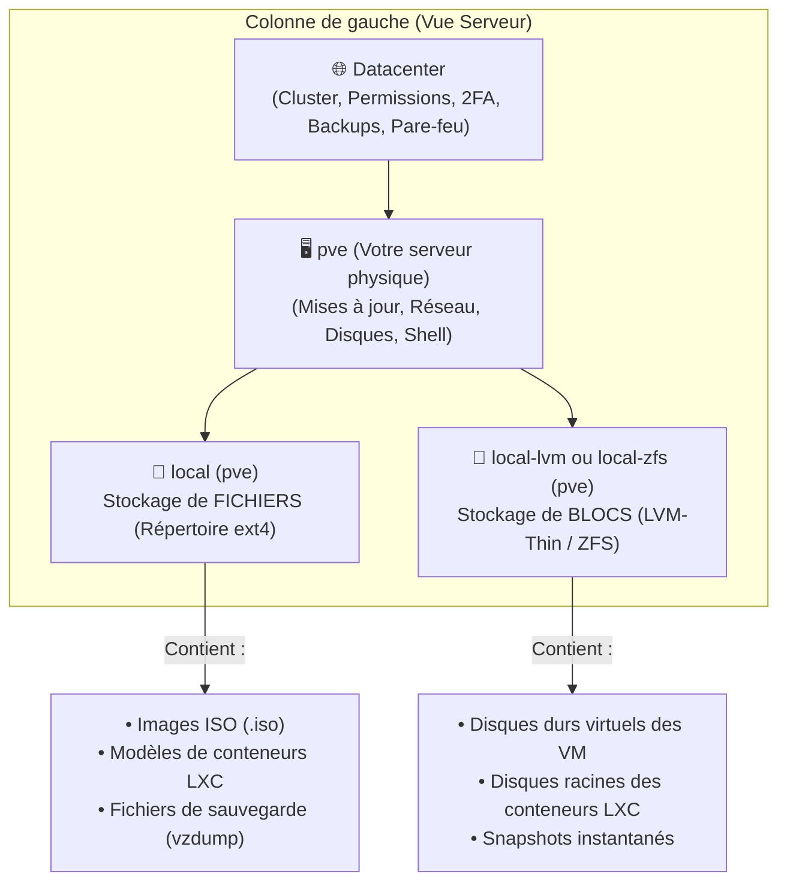
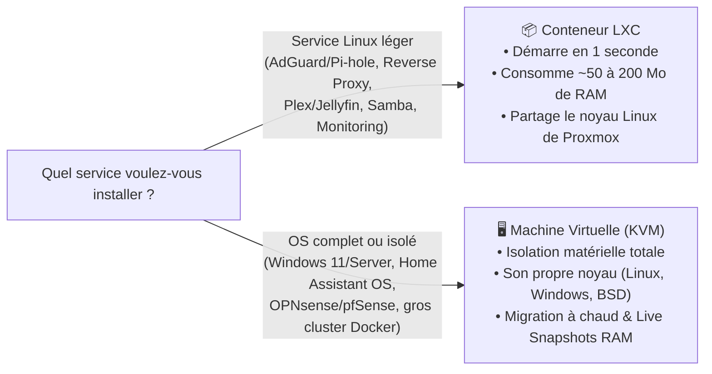

# Chapitre 05 : Premiers Pas — Stockages, 1er Conteneur LXC et 1ère VM

[⬅️ Chapitre précédent : Aide-Mémoire CLI](./04-aide-memoire-commandes.md) | [🏠 Retour à l'accueil](../README.md)

---

Votre serveur Proxmox VE est installé, mis à jour et sécurisé. Il est maintenant temps de lancer vos premiers services !

Avant de cliquer sur **`Créer VM`** ou **`Créer CT`** en haut à droite de l'interface Web, ce chapitre vous explique les **3 concepts fondamentaux** qui piègent tous les débutants sur Proxmox :
1. La différence entre les stockages **`local`** et **`local-lvm`** (ou `local-zfs`).
2. Quand choisir un **Conteneur LXC** plutôt qu'une **Machine Virtuelle (VM)**.
3. Comment déployer votre premier conteneur LXC en **60 secondes** et votre première VM Linux/Windows avec les bons réglages (`VirtIO`, `QEMU Guest Agent`).

---

## 📑 Table des matières

1. [Comprendre l'interface Web et la différence `local` vs `local-lvm`](#1-comprendre-linterface-web-et-la-différence-local-vs-local-lvm)
2. [Conteneur LXC ou Machine Virtuelle (VM) : que choisir ?](#2-conteneur-lxc-ou-machine-virtuelle-vm--que-choisir-)
3. [Créer votre 1er Conteneur LXC en 60 secondes (Debian / Ubuntu)](#3-créer-votre-1er-conteneur-lxc-en-60-secondes-debian--ubuntu)
4. [Télécharger une image ISO directement depuis Proxmox](#4-télécharger-une-image-iso-directement-depuis-proxmox)
5. [Créer votre 1ère Machine Virtuelle (VM) avec les réglages optimaux](#5-créer-votre-1ère-machine-virtuelle-vm-avec-les-réglages-optimaux)
6. [Configurer une sauvegarde automatique (Backup `vzdump`)](#6-configurer-une-sauvegarde-automatique-backup-vzdump)

---

## 1. Comprendre l'interface Web et la différence `local` vs `local-lvm`

Dans la colonne de gauche de Proxmox (`Vue Serveur`), vous voyez votre nœud (ex: **`pve`**) et deux espaces de stockage créés automatiquement lors de l'installation :



| Nom du stockage | Type | À quoi sert-il ? | Pourquoi je ne vois pas mes ISO dans `local-lvm` ? |
| :--- | :--- | :--- | :--- |
| **`local`** | Répertoire (`ext4` dans `/var/lib/vz`) | Stocker des **fichiers** : images `.iso`, templates de conteneurs LXC et sauvegardes. | C'est ici qu'il faut cliquer pour télécharger une ISO ! |
| **`local-lvm`** *(ou `local-zfs`)* | Bloc (`LVM-Thin` ou `ZFS`) | Stocker les **disques virtuels** de vos VM et conteneurs LXC avec support des **Snapshots**. | Un stockage en mode *Bloc* n'a pas de système de fichiers pour accueillir un fichier `.iso`, il ne stocke que des disques virtuels bruts ultra-rapides. |

---

## 2. Conteneur LXC ou Machine Virtuelle (VM) : que choisir ?



> [!TIP]
> **Règle pratique pour Docker :**
> Bien qu'il soit possible de faire tourner Docker dans un conteneur LXC (en activant l'option *Nesting*), **la documentation officielle de Proxmox recommande fortement d'installer Docker dans une Machine Virtuelle (VM) Debian ou Ubuntu dédiée**. Cela évite qu'une mise à jour du noyau Proxmox ou d'AppArmor ne casse vos conteneurs Docker.

---

## 3. Créer votre 1er Conteneur LXC en 60 secondes (Debian / Ubuntu)

Les conteneurs LXC n'ont pas besoin d'image ISO ni d'installation manuelle : ils se déploient à partir d'un **Modèle (Template)** officiel de quelques dizaines de mégaoctets.

### Étape A : Télécharger le modèle Debian 12 (ou Ubuntu 24.04)
1. Dans la colonne de gauche, déroulez votre nœud **`pve`** ➔ cliquez sur le stockage **`local (pve)`**.
2. Cliquez sur **`Modèles de CT` (*CT Templates*)** dans le menu central.
3. Cliquez sur le bouton **`Modèles` (*Templates*)** en haut.
4. Cherchez **`debian-12-standard`** (ou **`ubuntu-24.04-standard`**) ➔ cliquez sur **`Télécharger` (*Download*)**. En 5 secondes, le modèle est prêt !

### Étape B : Déployer le conteneur
1. Cliquez sur le bouton bleu **`Créer CT` (*Create CT*)** tout en haut à droite de l'écran.
2. **Général** :
   * **Nom d'hôte** : ex: `mon-premier-lxc`
   * **Case « Conteneur non privilégié » (*Unprivileged container*)** : **Laissez coché** (beaucoup plus sécurisé : l'utilisateur `root` du conteneur n'est pas `root` sur l'hôte Proxmox).
   * Saisissez un **mot de passe** (et/ou importez votre clé publique SSH).
3. **Modèle (Template)** : Sélectionnez `local` puis votre image `debian-12-standard...`.
4. **Disques** : Stockage `local-lvm` (ou `local-zfs`), taille **`8 Go`** (suffit largement pour un service Linux).
5. **CPU** : `1` ou `2` cœurs.
6. **Mémoire** : `512 Mio` ou `1024 Mio` (1 Go).
7. **Réseau** :
   * Pont : `vmbr0`
   * **IPv4** : choisissez **`DHCP`** (pour tester rapidement) ou **`Statique`** (ex: `192.168.1.201/24` + Passerelle `192.168.1.1`).
8. **Confirmation** : Cochez **`Démarrer après création`** et cliquez sur **`Terminer`**.

⚡ En **moins de 3 secondes**, votre conteneur est démarré ! Cliquez dessus dans la colonne de gauche puis sur **`Console`** pour vous connecter avec `root`.

---

## 4. Télécharger une image ISO directement depuis Proxmox

Pour créer une Machine Virtuelle (Debian, Ubuntu Server, Windows, Home Assistant...), plus besoin de télécharger l'ISO sur votre PC puis de l'envoyer vers le serveur : **Proxmox peut télécharger l'ISO directement depuis Internet à la vitesse maximale de votre fibre !**

1. Cliquez sur le stockage **`local (pve)`** dans la colonne de gauche.
2. Cliquez sur **`Images ISO`**.
3. Cliquez sur le bouton **`Télécharger à partir d'une URL` (*Download from URL*)**.
4. Collez l'URL directe de l'ISO (par exemple l'ISO *netinst* officielle de Debian 12) :
   ```text
   https://cdimage.debian.org/debian-cd/current/amd64/iso-cd/debian-12.9.0-amd64-netinst.iso
   ```
5. Cliquez sur **`Interroger l'URL` (*Query URL*)** puis sur **`Télécharger` (*Download*)**.

---

## 5. Créer votre 1ère Machine Virtuelle (VM) avec les réglages optimaux

Cliquez sur le bouton **`Créer VM` (*Create VM*)** en haut à droite et suivez ces recommandations onglet par onglet pour obtenir des **performances natives** :

| Onglet | Paramètre | Valeur recommandée | Pourquoi ce choix ? |
| :--- | :--- | :--- | :--- |
| **1. Général** | Nom | ex: `vm-docker` | cochez *Démarrer au boot* si la VM doit se lancer à l'allumage du serveur. |
| **2. OS** | Image ISO | Votre fichier `.iso` dans `local` | Pour Windows 11, cochez en plus *Ajouter un stockage supplémentaire pour les pilotes VirtIO*. |
| **3. Système** | Machine<br>BIOS<br>Contrôleur SCSI<br>**Agent invité QEMU** | **`q35`**<br>**`OVMF (UEFI)`** *(+ disque EFI sans clés pré-enregistrées pour Linux)*<br>**`VirtIO SCSI single`**<br>✅ **Cocher `Agent invité QEMU`** | `q35` + `UEFI` émule un PC PCIe moderne.<br>`VirtIO SCSI single` offre les meilleures performances disque.<br>`QEMU Guest Agent` permet à Proxmox de voir l'IP de la VM et de l'éteindre proprement. |
| **4. Disques** | Bus/Périphérique<br>Stockage<br>**Discard**<br>**IO thread** | **`SCSI`**<br>`local-lvm` ou `local-zfs`<br>✅ **Cocher `Discard`**<br>✅ **Cocher `IO thread`** | **`Discard` (TRIM)** est indispensable sur SSD pour libérer l'espace quand vous supprimez un fichier dans la VM !<br>**`IO thread`** dédie un thread par disque pour maximiser les IOPS. |
| **5. CPU** | Cœurs<br>**Type** | `2` ou `4` cœurs<br>**`host`** *(au lieu de `x86-64-v2-AES`)* | Le type **`host`** expose 100 % des instructions de votre vrai processeur (AVX2, AES-NI) à la VM sans aucune perte de performance. |
| **6. Mémoire** | Mémoire (Mio) | ex: `4096` (4 Go) | Décochez *Ballooning* si vous faites du Passthrough PCIe dans cette VM. |
| **7. Réseau** | Modèle | **`VirtIO (paravirtualisé)`** | Carte réseau virtuelle 10 Gbps+ ultra-rapide et reconnue nativement sous Linux. |

### Une fois la VM Linux installée : activez l'Agent Invité QEMU (`qemu-guest-agent`)
Connectez-vous dans votre nouvelle VM Debian/Ubuntu et installez le paquet de communication avec Proxmox :

```bash
sudo apt update && sudo apt install -y qemu-guest-agent
sudo systemctl enable --now qemu-guest-agent
```

Dès qu'il est installé, l'onglet **`Résumé` (*Summary*)** de votre VM dans Proxmox affichera en temps réel son **adresse IP** et sa consommation exacte de mémoire RAM !

---

## 6. Configurer une sauvegarde automatique (Backup `vzdump`)

Ne laissez jamais tourner une VM ou un conteneur sans sauvegarde automatique :

1. Cliquez sur **`Datacenter`** (tout en haut à gauche) ➔ **`Sauvegarde` (*Backup*)**.
2. Cliquez sur **`Ajouter` (*Add*)**.
3. Configurez votre tâche planifiée :
   * **Stockage** : votre disque secondaire, votre NAS (NFS/SMB), votre **Proxmox Backup Server (PBS)** ou à défaut `local`.
   * **Planification (Schedule)** : ex: `Chaque jour à 03:00` (`03:00`).
   * **Mode de sélection** : `Tout` (*All*) ou sélectionnez vos VM/LXC critiques.
   * **Compression** : **`ZSTD` (rapide et bon)** (de loin le meilleur ratio vitesse/compression).
   * **Mode** : **`Snapshot`** (sauvegarde à chaud sans couper vos VM !).
4. Dans l'onglet **`Rétention` (*Retention*)**, indiquez combien de sauvegardes conserver (ex: `keep-daily: 7`, `keep-weekly: 4`, `keep-monthly: 2`) pour ne jamais saturer votre disque de sauvegarde.
5. Cliquez sur **`Créer`**.
